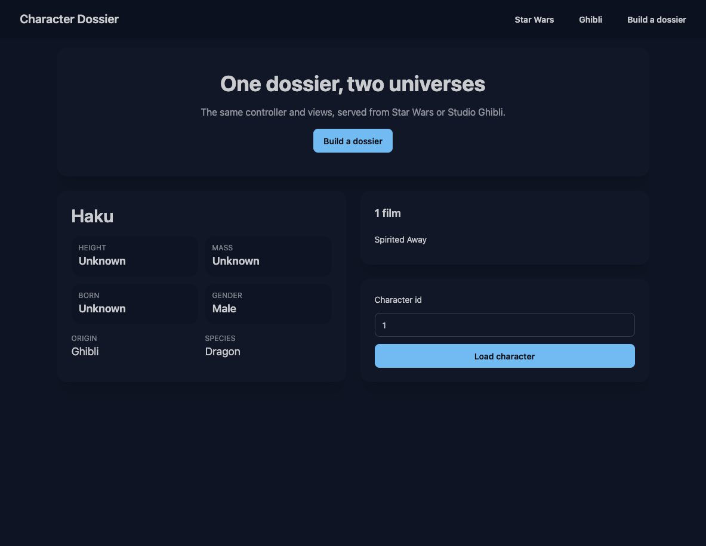

# next-mvc-example

One character-dossier UI, served from two film universes: Star Wars through
SWAPI and Studio Ghibli through the Ghibli API. Controllers, view models, and
views are shared. Each experience page module supplies its own runtime and
daisyUI theme; the home and funnel modules also supply their server actions.

| Star Wars (`/star-wars`, night) | Studio Ghibli (`/ghibli`, autumn) |
| --- | --- |
|  |  |

```sh
pnpm install
cp .env.example .env.local
pnpm dev
```

Open `/star-wars` or `/ghibli`.

## Routes

| Experience | Home | Funnel | Results |
| --- | --- | --- | --- |
| Star Wars | `/star-wars` | `/star-wars/funnel` | `/star-wars/results` |
| Studio Ghibli | `/ghibli` | `/ghibli/funnel` | `/ghibli/results` |

The root controller returns a `NextRedirect` to `/star-wars`. The AppShell
header switches between the two experiences.

## Page shape

Each route file re-exports one page module. A page module is the only
composition point: it passes a `ManagedRuntime` and a program to
`makeNextPage`.

```tsx
export const StarWarsFunnelPage = makeNextPage(
  swapiRuntime,
  Effect.map(startFunnel("night"), (model) => (
    <ConnectedFunnel model={model} submitAction={submitFunnel} />
  )),
);
```

- A page program returns a React tree or a `NextRedirect`.
  `handleNextRedirect` is the only module that calls `next/navigation.redirect`.
- `makeNextPage` provides the raw Next `searchParams` as the
  `ParsedSearchParams` service. The page program decodes its own schema with
  `ParsedSearchParams.decodeOption`; the adapter takes no params schema.
- The root page uses the same adapter with a minimal `ManagedRuntime`.
- Page view models carry their own `AppShellViewModel`. The views render the
  shell (brand, links, and theme), so `app/layout.tsx` is only `<html>` and
  `<body>`.
- The AppShell sets `data-theme`: `night` for Star Wars, `autumn` for Ghibli.
  The page views do not know which theme is active.

## What it shows

- Every model is a `Schema.TaggedStruct` or `Schema.TaggedUnion`; nested models
  carry their own `_tag`.
- `CharacterId` is a branded string built from `Schema.NumberFromString`, so
  `Person.id` and `PeopleCatalog.getPerson` accept only a validated id.
- Every user-visible string is carried by the view model; views contain no copy.
- `PeopleCatalog` is the port: `getPerson` and `searchPeople`, with
  `PeopleCatalogError`. Two adapters implement it:
  - `SwapiPeopleCatalog` maps SWAPI people, films, planets, species, starships,
    and vehicles into the domain.
  - `GhibliPeopleCatalog` maps Ghibli people, films, and species. The array index
    is the character id; missing measurements are `unknown`; transports are empty.
- `Film.imageUrl` is optional. The Ghibli adapter fills it from the film API's
  `image` field; SWAPI has no image field. The film list, funnel choices, review,
  and results render the poster only when it exists.
- `FunnelViewModel` is a tagged union of `Search`, `Choose`, `Film`, `Transport`,
  `Review`, and `Failed`. `Funnel.controller.ts` advances it with an exhaustive
  Effect `Match`.
- The results page requires `character`, `film`, and `transport`; a URL missing
  one of them renders the `Missing` state. `transport=none` is an explicit
  choice, not a default.
- The review link is relative (`results?...`); the results page's links use the
  selected universe's base path.
- `searchPerson`, `searchGhibliPerson`, `submitFunnel`, and
  `submitGhibliFunnel` are server actions. `HomePage.connected.tsx` and
  `Funnel.connected.tsx` are the two `"use client"` boundaries.

## Storybook

```sh
pnpm storybook
```

The stories in `src/components/*.stories.tsx` render the three top-level page
views. Every tagged view-model variant is represented, including pending,
validation-error, known-species, film-poster, transport/no-transport, and both
`night` and `autumn` shells. `.storybook/pageFixtures.ts` builds the models from
the app fixtures and view-model factories; `HomePageOptics` derives the form
value and validation-error variants.

`pnpm build-storybook` writes a static site to `storybook-static/`.

## Layout

```text
.oxlintrc.json               Effect Oxlint preset and boundary overrides
.storybook/                  Storybook config and page fixtures
app/                         route re-exports; html/body layout
src/page-modules/            one Next page per route via makeNextPage
src/platform/                Next adapter, redirect model, parsed params
src/controllers/             page programs, state machines, view models
src/components/              flat view models and views (AppShell included)
src/actions/                 "use server" boundaries
src/domain/                  universe-neutral models
src/services/                PeopleCatalog port and both adapters
features/                    Gherkin plus inline step modules
```

`src/pages` is reserved by the Next Pages Router, so page modules use the
`src/page-modules` name.

## Commands

```sh
pnpm dev
pnpm test
pnpm test:coverage
pnpm typecheck
pnpm build
pnpm check
pnpm lint
pnpm lint:fix
pnpm test:e2e
pnpm test:e2e:debug
pnpm storybook
pnpm build-storybook
```

`pnpm test:e2e` builds the app, then runs `test:e2e:run` with `--parallel=2`.
`pnpm test:e2e:debug` reuses the same runner with `E2E_DEBUG=1 --parallel=1
--verbose`, pausing after each browser interaction and recording one WebM per
feature. The shared command owns the feature/steps globs, reporter, strict mode,
and step timeout.

## Integration tests

Six features and 17 scenarios cover both universes:

- Star Wars home: configured character, another character, invalid id, unknown id.
- Ghibli home: configured character, unknown id.
- Navigation: root redirect and theme, header switch and theme.
- Star Wars funnel: review, open dossier, no search matches.
- Star Wars results: complete dossier, missing transport, unknown transport,
  explicit no transport.
- Ghibli funnel: Haku dossier without transport, no search matches.

Each scenario starts its own `next start -p 0`, so the OS assigns a free port,
and closes the server and browser when it ends. The steps are declared inline in
each feature's `.steps.ts`, top to bottom. Scenarios use the live SWAPI and
Ghibli APIs, so they need a network connection. A failure writes a full-page
screenshot under `artifacts/`; debug mode also needs ffmpeg.

```sh
CHROMIUM_PATH="/Applications/Google Chrome.app/Contents/MacOS/Google Chrome" \
  pnpm test:e2e
```

## Checks

```sh
pnpm check
pnpm typecheck
pnpm lint
pnpm lint:fix
```

`typecheck` runs the Effect-patched TypeScript-Go compiler. `lint` runs
type-aware Oxlint with the recommended Effect preset. `check` runs both, and
the `prepare` script patches TypeScript and Oxlint after install. The
`unstable-api-usage` warning is disabled only at the experimental
`effect/http`, `effect/http-api`, and test/e2e boundaries.

## Requirements

- Node.js 22.12+
- pnpm 10
- Chrome or Chromium for the browser scenarios
- ffmpeg for `pnpm test:e2e:debug`

Copy `.env.example` to `.env.local` to set the starting character and API
hosts. The example values are `CHARACTER_ID=1`,
`STAR_WARS_API_URL=https://swapi.dev/api`, and
`GHIBLI_API_URL=https://ghibliapi.vercel.app`.
