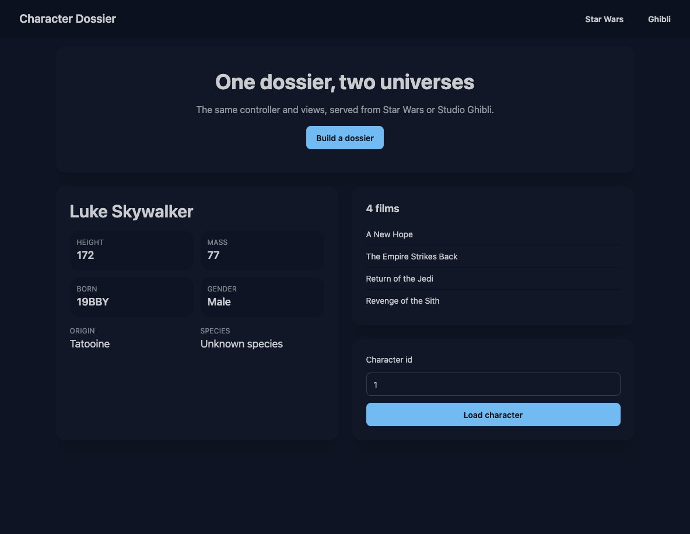

# next-mvc-example

## Why this project exists

This is a reference for maintaining a production Next.js App Router
application with Effect. Next leaves the application architecture to you;
this repo shows one that stays explicit:

- a controller is an Effect. It loads and parses data, then hands domain
  objects to one top-level model factory;
- model factories are pure and synchronous. They hold the rendering and
  business logic that turns domain values into a view model;
- views render a view model and nothing else;
- the request's Effect context is bridged into Next's render, so the same
  controllers run in production and in the browser suite with stubbed
  catalogs.

The demo exists because those boundaries are easy to lose as a Next app grows:
module-level clients, ambient configuration, and route handlers that mix
loading, decisions, and markup. Keeping them explicit is what makes the pages
testable without a network and the adapters replaceable.

A new application that can choose its stack should look at
[Foldkit](https://foldkit.dev), a TypeScript framework built on Effect that
makes this architecture the framework's own. One `Model`, explicit `Message`
values, a pure `update` that returns the next model and its `Command`s, and a
runtime that executes them. Foldkit enforces the separation this demo builds
by hand, and it handles server rendering and hydration itself. The tradeoff is
leaving React and Next, which this project cannot do: it is here to show the
discipline inside an existing Next codebase.

## What it is

One character-dossier UI, served from two film universes: Star Wars through
SWAPI and Studio Ghibli through the Ghibli API. Controllers, view models, and
views are shared. Each experience's routes carry its catalog and daisyUI
theme; the funnel modules also supply their server actions.

| Star Wars (`/star-wars`, night) | Studio Ghibli (`/ghibli`, autumn) |
| --- | --- |
|  |  |

```sh
pnpm install
cp .env.example .env.local
pnpm dev
```

Open `/star-wars` or `/ghibli`. `pnpm dev` builds the Next app, then serves it
through the Effect HTTP server in `server.ts`.

## Routes

| Experience | Home | Funnel | Results |
| --- | --- | --- | --- |
| Star Wars | `/star-wars` | `/star-wars/funnel` | `/star-wars/results` |
| Studio Ghibli | `/ghibli` | `/ghibli/funnel` | `/ghibli/results` |

The root controller returns a `NextRedirect` to `/star-wars`. The AppShell
header switches between the two experiences.

## Page shape

Each route file re-exports one page module. A page module names its program;
`makeNextPage` runs it with the request's Effect context.

```tsx
export const StarWarsFunnelPage = makeNextPage(
  Effect.map(startFunnel("night"), (model) => (
    <ConnectedFunnelView
      model={model}
      submitAction={submitStarWarsFunnel}
      universe="star-wars"
    />
  )),
);
```

- A page program returns a React tree or a `NextRedirect`.
  `handleNextRedirect` is the only module that calls `next/navigation.redirect`.
- `makeNextPage` provides the raw Next `searchParams` as the
  `ParsedSearchParams` service, then runs the program with the request context
  bridged from `boot/next.ts`. The program decodes its own schema with
  `ParsedSearchParams.decodeOption`; the adapter takes no params schema.
- The program is a controller Effect. It decodes and loads, then hands domain
  values to one pure model factory, which decides the page state and builds
  the view model.
- The request context carries `I18n` and one `PeopleCatalog`: the
  `/star-wars` routes provide the SWAPI adapter, the `/ghibli` routes the
  Ghibli one. A page never chooses its adapter.
- The root page uses `makeRedirectNextPage`, which needs no context.
- Page view models carry their own `AppShellViewModel`. The views render the
  shell (brand, links, and theme), so `app/layout.tsx` is only `<html>` and
  `<body>`.
- The AppShell sets `data-theme`: `night` for Star Wars, `autumn` for Ghibli.
  The page views do not know which theme is active.
- Each home page is a splash: a universe image with a visible credit and one
  CTA into that universe's funnel. It loads no character data.
- `server.ts` is the process entrypoint. `boot/live.ts` provides the live
  catalogs, `boot/app.ts` mounts the Effect `HttpApi` endpoint at
  `/api/ui-events` plus a Next catch-all per universe, and `boot/serve.ts`
  owns the socket. Run `next build` before `pnpm start`; `pnpm dev` does the
  build first.

## What it shows

- Controllers are Effects; every model factory is a pure synchronous function
  over domain values and i18n.
- Every model is a `Schema.TaggedStruct` or `Schema.TaggedUnion`; nested models
  carry their own `_tag`.
- `CharacterId` is a branded string built from `Schema.NumberFromString`, so
  `Person.id` and `PeopleCatalog.getPerson` accept only a validated id.
- Every user-visible string is carried by the view model; views contain no copy.
- `PeopleCatalog` is the port: `getPerson` and `searchPeople`, with
  `PeopleCatalogError`. Two adapters implement it:
  - `SwapiPeopleCatalog` maps SWAPI people, films, planets, species, starships,
    and vehicles into the domain.
  - `GhibliPeopleCatalog` maps Ghibli people, films, and species. The array index
    is the character id; missing measurements are `unknown`; transports are empty.
- `Film.imageUrl` is optional. The Ghibli adapter fills it from the film API's
  `image` field; SWAPI has no image field. The film list, funnel choices, review,
  and results render the poster only when it exists.
- `FunnelViewModel` is a tagged union of `Search`, `Choose`, `Film`, `Transport`,
  `Review`, and `Failed`. `Funnel.controller.ts` advances it with an exhaustive
  Effect `Match`.
- The results page requires `character`, `film`, and `transport`; a URL missing
  one of them renders the `Missing` state. `transport=none` is an explicit
  choice, not a default.
- The review link is relative (`results?...`); the results page's links use the
  selected universe's base path.
- `submitStarWarsFunnel` and `submitGhibliFunnel` are the server actions.
  `HomeView.connected.tsx`, `FunnelView.connected.tsx`, and
  `ResultsView.connected.tsx` are the client event boundaries.

## UI events

UI events are typed, JSON-shaped domain facts emitted from the connected page
components:

- `PageLoaded`
- `CtaClicked`
- `FormValidationError`
- `InputFilled`

`PageLoaded` and `CtaClicked` carry a discriminated page context instead of a
bag of optional fields. The context is `Home`, a funnel stage (`FunnelSearch`,
`FunnelChoose`, `FunnelFilm`, `FunnelTransport`, `FunnelReview`,
`FunnelFailed`), or a results outcome (`ResultsMissing`, `ResultsReady`). Each
variant carries only the facts that state has, so a home page load cannot carry
a film order and a funnel review always has a transport. A transport is
`TransportChosen` with its key or `NoTransport`, never a missing optional key.
`FormValidationError` and `InputFilled` exist only for the funnel search, and
no event payload uses an optional field.

`CtaClicked` is a closed union with one variant per page state: the home CTA,
each funnel stage's CTA, and each results outcome's CTA. A search click cannot
carry a review CTA. `makeUiEventHandler` transforms an event
into a flat `UiEventPayload` with `event`, `page`, `universe`, `occurredAt`,
and `properties`, then sends it to every injected `UiEventSink`. The sink
keeps the flat property names (`characterId`, `filmOrder`, `transportKey`,
`query`, and so on).

`AppUiEventProvider` mounts the handler once at the root. The default list has
two sinks: `ConsoleUiEventSink.ts` logs the payload, and
`BeaconUiEventSink.ts` posts it with `navigator.sendBeacon` to
`/api/ui-events`. A failing sink is logged and does not stop the others, so a
new destination is one entry in the list. Connected `HomeView` supplies
page-load and CTA events, `FunnelView` supplies input, validation, and CTA
events, and `ResultsView` supplies page-load and CTA events.

`src/api/UiEventApi.ts` defines `POST /api/ui-events`; `src/api/UiEventApi.layer.ts`
logs each payload through `UiEventLogger`. `server.ts` serves that API and the
Next catch-all from one Effect HTTP server, so the endpoint is not a Next route.
The default layer uses the Effect logger; `UI_EVENT_LOGGER=noop` swaps in a noop
layer, and the integration harness sets it so event traffic does not fill the
test output.

## Storybook

```sh
pnpm storybook
```

The stories in `src/components/*.stories.tsx` render the three top-level page
views, split by universe. Every tagged view-model variant is represented, including pending,
validation-error, known-species, film-poster, transport/no-transport, and both
`night` and `autumn` shells. `.storybook/pageFixtures.ts` builds the models from
the app fixtures and view-model factories.

`pnpm build-storybook` writes a static site to `storybook-static/`.

## Layout

```text
.oxlintrc.json               Effect Oxlint preset and boundary overrides
.storybook/                  Storybook config and page fixtures
server.ts                    process entrypoint: the live app on the configured port
boot/                        app composition, live wiring, socket, and Next bridge
app/                         route re-exports; html/body layout
src/api/                     UiEventApi definition and handler layer
src/page-modules/            one Next page per route via makeNextPage
src/platform/                Next adapter, redirect model, parsed params
src/controllers/             page programs, state machines, view models
src/components/              flat view models and views (AppShell included)
src/ui-events/               event model, payload, handler, sinks, and React provider
src/server/                  Next service, render context, and UI event logger
src/actions/                 "use server" boundaries
src/domain/                  universe-neutral models
src/i18n/                    messages and the i18n service
src/forms/                   form-data helpers
src/services/                PeopleCatalog port and both adapters
features/                    Gherkin, shared steps, and the stubbed scenario app
```

`src/pages` is reserved by the Next Pages Router, so page modules use the
`src/page-modules` name.

## Commands

```sh
pnpm dev
pnpm start
pnpm test
pnpm test:coverage
pnpm typecheck
pnpm build
pnpm check
pnpm lint
pnpm lint:fix
pnpm test:e2e
pnpm test:e2e:debug
pnpm storybook
pnpm build-storybook
```

`pnpm test:e2e` builds the app, then runs `test:e2e:run` with `--parallel=2`.
`pnpm test:e2e:debug` reuses the same runner with `E2E_DEBUG=1 --parallel=1
--verbose`, pausing after each browser interaction and recording one WebM per
feature. The shared command owns the feature/steps globs, reporters, strict
mode, and step timeout. Each run writes `reports/junit.xml` and
`reports/report.html`.

## Integration tests

Four features and 26 scenarios cover both universes:

- Home: the universe splash and its funnel CTA.
- Funnel: review and open a dossier, the no-match search, and an unavailable
  catalogue.
- Results: complete, missing transport, unknown transport, explicit no
  transport, and an unavailable catalogue.
- Navigation: the app root and the header switch.

Each feature is a Scenario Outline with a `universe` column, so adding an API
is a row in the examples tables. The Ghibli rows cover the same home, funnel,
results, and navigation states as Star Wars, including the Ghibli vehicle
transport.

Each scenario boots `boot/app.ts` in-process on an OS-assigned port through
`boot/serve.ts`, providing the stub catalogs from
`features/support/ScenarioApp.ts`, and closes the app and the browser when the
scenario ends. The stubs serve the domain fixtures, so the suite needs no
network; `Given the catalogue is unavailable` switches them to their failure
path. Shared steps are declared in `features/support/Steps.ts`, and each
feature's `.steps.ts` composes the scenarios. A failure writes a full-page
screenshot under `artifacts/`; debug mode also needs ffmpeg.

```sh
CHROMIUM_PATH="/Applications/Google Chrome.app/Contents/MacOS/Google Chrome" \
  pnpm test:e2e
```

## Checks

```sh
pnpm check
pnpm typecheck
pnpm lint
pnpm lint:fix
```

`typecheck` runs the Effect-patched TypeScript-Go compiler. `lint` runs
type-aware Oxlint with the recommended Effect preset. `check` runs both, and
the `prepare` script patches TypeScript and Oxlint after install. The
`unstable-api-usage` warning is disabled only at the experimental Effect
HTTP/API/server and test/e2e boundaries.

## Requirements

- Node.js 22.12+
- pnpm 10
- Chrome or Chromium for the browser scenarios
- ffmpeg for `pnpm test:e2e:debug`

Copy `.env.example` to `.env.local` to point either adapter at another host.
The example values are `STAR_WARS_API_URL=https://swapi.dev/api` and
`GHIBLI_API_URL=https://ghibliapi.vercel.app`. The browser suite ignores both;
it provides stub catalogs. `server.ts` reads `PORT` (default `3000`);
`UI_EVENT_LOGGER=console` is the default and `noop` drops UI event logs.
